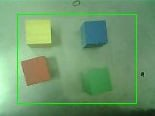

# ESP32-CAM 큐브 색상·크기 판별기

ESP32-CAM 하나로 판 위에 놓인 육면체(큐브)의 **색상**과 **크기**를 판별하고, 그 결과를 **RS-485(Modbus RTU)** 로 PLC에 제공하는 펌웨어입니다. 같은 결과와 카메라 영상, 통신 상태는 Wi-Fi 웹 화면에서도 볼 수 있습니다.



## 목적

- 자동화 실습 라인에서 PLC가 **어떤 큐브가 놓였는지**(색상 6종, 크기 3종)를 받아 분류·이송 등 다음 동작을 결정할 수 있게 한다.
- 별도 PC나 산업용 비전 장비 없이, 저가 카메라 모듈 하나로 판별부터 PLC 통신까지 처리한다.
- 설치 현장에서 노트북이나 USB 장비 없이도 브라우저만으로 카메라·판별·통신 상태를 확인할 수 있게 한다.

## 주요 기능

| 기능 | 내용 |
|---|---|
| 물체 감지 | 빈 판을 배경으로 학습해 두고, 배경과 달라진 영역을 물체로 찾는다. 놓일 때 한 번만 판정하고, 치우면 제거를 알린다. |
| 색상 판별 | 흰색·검정색·빨간색·노란색·초록색·파란색 (6종) |
| 크기 판별 | 카메라 기울기(원근)와 옆면을 보정해 윗면 길이(mm)를 추정하고 소(35mm)·중(55mm)·대(75mm)로 구분 (3종). 회전·위치와 무관 |
| 판별 기준 선택 · 현장 학습 | 학습 데이터로 맞춘 판별 기준(학습 1 / **학습 2, 기본** / 현장 학습)을 웹에서 고름. 웹 학습 모드에서 모은 샘플로 장치가 기준을 직접 계산·저장(펌웨어 재업로드 불필요) |
| 확정 후 잠금 | 확정 뒤 일정 시간(기본 5초) 새 판정을 멈춰, 집어 옮기는 움직임을 새 물체로 보지 않음. 40010 또는 웹에서 변경 |
| PLC 통신 | Modbus RTU 슬레이브, 홀딩 레지스터 40001~40009 (FC03) / 같은 값의 입력 레지스터 30001~30009 (FC04) |
| 웹 모니터링 | 실시간 영상·전경 마스크, 판별 결과, 감지 기록(로그), Modbus 레지스터 값, 통신·카메라 상태 |
| PLC 명령 (40009) | 1 초기화(배경 재학습 + 감지 결과·누적 감지 횟수 0), 2 배경 재학습, 3 감지 결과 초기화, 4 다시 판정. 진행 상태(실행 중·완료·실패)를 같은 레지스터로 돌려줌. 웹 화면에서도 실행 가능 |

자세한 내용은 다음 문서를 참고하세요.

- **[DETECT.md](DETECT.md)** — 물체 감지, 색상 구분, 크기 구분 방법과 조정 방법
- **[MODBUS.md](MODBUS.md)** — Modbus 통신 설정, 레지스터 맵, PLC 프로그램 작성, 배선 방법

## 시스템 구성

```
            (위에서 내려다봄)
        ┌──────────────────┐   Wi-Fi    ┌──────────────┐
        │    ESP32-CAM     │ ─────────► │ 웹 브라우저   │  영상·결과·통신 상태 확인
        │  (OV2640 카메라)  │            └──────────────┘
        └────────┬─────────┘
                 │ UART0 (U0T=GPIO1 / U0R=GPIO3) — 둘 중 하나만 연결
         ┌───────┴──────────────┐
    운용 ▼                       ▼ 개발·업로드
 ┌──────────────┐        ┌──────────────┐
 │ TTL485 모듈   │        │ ESP32-CAM-MB │ ── USB ── PC
 └──────┬───────┘        └──────────────┘
        │ RS-485 (A/B)
        ▼
 ┌───────────────────┐
 │ PLC (Modbus 마스터) │
 └───────────────────┘

   카메라 아래: 은색(스테인리스) 판 + 큐브
```

## 준비물

| 품목 | 비고 |
|---|---|
| AI-Thinker ESP32-CAM | OV2640 카메라, PSRAM 탑재 보드 |
| ESP32-CAM-MB | USB 업로드·시리얼 모니터용 (개발할 때만) |
| TTL485-V2.0 모듈 | TTL ↔ RS-485 변환, 송수신 방향 자동 전환 (MAX485 계열도 가능 — [MODBUS.md](MODBUS.md) 참고) |
| 5V 전원 | 1A 이상. 제어반이 24V면 24V→5V DC-DC 컨버터 |
| 은색(스테인리스) 판 | 배경. 무채색이어야 색 판별이 안정적 |
| 큐브 | 단면 35×35mm, 길이 35 / 55 / 75mm, 6색 |

카메라는 판 위에 고정해 아래를 내려다보도록 설치합니다. 설치 후 카메라나 판이 움직이면 배경을 다시 학습해야 합니다.

## 빠른 시작

### 1. 설정 바꾸기

모든 설정은 [src/main.cpp](src/main.cpp) 맨 위에 있습니다.

| 설정 | 기본값 | 설명 |
|---|---|---|
| `ENABLE_WEB` | `true` | Wi-Fi 웹 화면 사용 |
| `ENABLE_MODBUS` | `true` | `true`: RS-485 Modbus 통신 (UART0: U0T/U0R) / `false`: 같은 핀으로 시리얼 로그 출력 |
| `SERIAL_LOG` | `!ENABLE_MODBUS` | 자동으로 정해짐. Modbus를 끄면 USB 시리얼 로그가 켜짐 (115200bps) |
| `ssid`, `password` | 실습실 공유기 | 접속할 Wi-Fi (2.4GHz만 가능) |
| `HOSTNAME` | `link-cam1` | 웹 접속 이름 → `http://link-cam1.local` |
| `WIFI_STATIC_IP` | `true` | 고정 IP 사용. `false`면 공유기가 주는 주소(DHCP) 사용 |
| `STATIC_IP_CANDIDATES` | `192.168.10.230` ~ `233` | 고정 IP 후보. 앞에서부터 비어 있는 첫 주소를 씀 ([Wi-Fi 연결 안정화](#wi-fi-연결-안정화) 참고) |
| `WIFI_11B_ONLY` | `false` | `true`면 802.11b 전용: 속도는 느리지만 먼 거리 수신 감도가 좋아짐 |
| `STREAM_MAX_FPS` | `5` | 웹 영상 최대 초당 프레임. 신호가 약할 때 상태 화면이 멈추지 않게 대역을 아낌 |
| `SLAVE_ID` | `6` | Modbus 슬레이브 ID. 같은 485 선에 연결된 장치끼리 겹치면 안 됨 |
| `MODBUS_BAUD` | `38400` | 통신 속도. PLC와 같아야 함 |

485 통신과 USB 시리얼 로그는 같은 UART0(U0T/U0R 핀)을 쓰므로 동시에 쓸 수 없습니다.
- **개발할 때**: `ENABLE_MODBUS = false`로 올려 시리얼 모니터로 로그를 봅니다.
- **현장에 설치할 때**: `true`로 바꿔 다시 업로드합니다.

Modbus를 켠 상태에서도 웹 화면의 **감지 기록**에서 같은 로그를 볼 수 있습니다.

### 2. 빌드와 업로드

1. VS Code + PlatformIO에서 이 폴더를 엽니다. (`platformio.ini`에 보드와 Modbus 라이브러리가 설정되어 있습니다.)
2. ESP32-CAM을 ESP32-CAM-MB에 꽂아 USB로 PC에 연결합니다. 485 모듈이 U0T/U0R에 연결되어 있으면 TXD·RXD 선을 먼저 빼세요. 연결된 채로는 업로드가 실패합니다.
3. PlatformIO의 **Upload**를 실행합니다.
4. **Monitor**로 시리얼 로그를 봅니다(115200bps). 시리얼 모니터가 열려 있으면 업로드가 실패하므로 업로드 전에 닫으세요.

`platformio.ini`의 `monitor_rts = 0`, `monitor_dtr = 0`은 모니터를 열 때 보드가 리셋되거나 업로드 모드로 들어가지 않게 하는 설정이니 지우지 마세요.

### 3. 첫 부팅 — 판을 비워 두세요

전원이 켜지면 약 3초 동안 **빈 판을 배경으로 학습**합니다. 이때 판 위에 물체나 손이 있으면 그 모습이 배경으로 굳어 판별이 틀어집니다. 판이 비어 있지 않았다면 치운 뒤 다음 중 하나로 다시 학습하세요.

- 웹 화면의 **배경 재학습** 버튼 (또는 **PLC 명령** 카드의 1·2번 **실행**)
- PLC에서 40009번지에 `1`(초기화: 배경 재학습 + 감지 결과·누적 횟수 0) 또는 `2`(배경 재학습만) 쓰기 — [MODBUS.md 3.3](MODBUS.md#33-plc-명령-40009)

웹 화면의 **감지 기록**에 다음과 같이 나오면 정상입니다. `ENABLE_MODBUS = false`일 때는 시리얼 로그에도 같은 내용이 나옵니다(`[485]` 줄은 빠짐).

```
[CAM] 카메라 정상 (센서 PID=0x26)
[485] Modbus RTU 시작: 슬레이브 ID 6, 38400bps 8N1, FC03 40001~40009 / FC04 30001~30009 (UART0 TX=GPIO1 RX=GPIO3)
[BG] 배경 학습 완료 (8프레임 평균) 판 RGB=(...) 게인 R... G... B...
[WiFi] 공유기 연결됨 (DHCP 192.168.10.57, 채널 3, RSSI -61 dBm) — 고정 IP 후보 확인 중
[WiFi] 고정 IP 192.168.10.230 사용 (게이트웨이 192.168.10.3, DHCP로 받았던 주소 192.168.10.57)
[WiFi] 연결됨: http://192.168.10.230 (http://link-cam1.local) 채널 3, RSSI -61 dBm, 고정 IP
```

`ENABLE_MODBUS = true`일 때 시리얼 모니터에는 아래 한 줄만 나오고 조용해집니다. UART0을 Modbus가 쓰기 때문이며 정상입니다.

```
[Info] Modbus 485 모드 (ENABLE_MODBUS=true): 이후 시리얼 로그 없음. 상태는 웹 http://link-cam1.local 에서 확인
```

큐브를 올리면 다음과 같이 판별 결과가 한 번 출력됩니다.

```
[#15] 색상 4:노란색 (R:198 G:181 B:62) | 크기 2:중(55mm) (추정 길이 54mm)
물체 제거됨 (확정 위치 점유율 3%, 남은 최대 덩어리 면적=0)
```

### 4. 웹 화면 접속

같은 Wi-Fi에 연결된 PC나 휴대폰 브라우저에서 **`http://192.168.10.230`** 으로 접속합니다.
- 230을 다른 장치가 쓰고 있었다면 231, 232, 233 순서로 확인하세요.
- `http://link-cam1.local`로도 접속할 수 있습니다. 다만 이름 접속(mDNS)은 공유기나 PC 설정에 따라 막히는 경우가 있어 IP 주소가 더 확실합니다.

## 웹 모니터링 화면

| 영역 | 내용 |
|---|---|
| 카메라 영상 | 왼쪽: 카메라 영상 + 추정한 물체 윗면 사각형 (노랑: 안정화 중, 초록: 확정, 빨강: 무효) / 오른쪽: 전경 마스크 (보라: 검정 보강 픽셀) |
| 학습 데이터 수집 | **기본은 숨김.** 상단 **학습 모드** 버튼으로 보이기/숨기기. 크기(소·중·대)·색상(6색) 정답 버튼, 판별 정확도와 혼동표, 샘플 목록, ZIP 내려받기 ([아래](#학습-데이터-수집) 참고) |
| 감지된 물체 | 마지막 판별 결과(색상 견본, 색상·크기, RGB, 추정 길이), 판 위 물체 유무, 현재 프레임 측정값(추정 길이×폭, 검정 보강 픽셀 수) |
| 감지 기록 | 감지·제거·배경 학습·Wi-Fi·485 통신·카메라 오류 등 주요 이벤트 (시리얼 로그와 같은 형식, 최근 40줄) |
| Modbus 레지스터 | 40001~40009의 현재 값과 의미. 값이 바뀌면 잠깐 강조 |
| PLC 명령 (40009) | 명령 1~4의 설명과 **실행** 버튼, 40009 현재 값, 마지막 명령 결과(출처·걸린 시간·실패 이유), 상태 값 표와 PLC 프로그램 작성 방법 |
| 판별 설정 | **판별 기준** 고르기(학습 1 / 학습 2 / 현장 학습)와 기준별 값 표, **확정 후 잠금** 시간 설정과 잠금 상태 |
| 통신 상태 | 수신 요청 수, 정상/오류 응답, 마지막 요청의 함수 코드·주소·결과 |
| 카메라 · 시스템 | 센서, 처리 속도(fps), 프레임 수신 실패, 가동 시간, 여유 메모리 |
| Wi-Fi | 공유기·채널, IP(고정/DHCP), 신호 세기(현재·1분 평균·최저), 끊김 횟수와 마지막 사유, **주변 채널 검사** |

웹 서버 주소 목록입니다.

| 주소 | 내용 |
|---|---|
| `/` | 모니터링 화면 |
| `/status` | 현재 상태 전체 (JSON) |
| `/events?since=N` | 감지 기록 중 N번 이후 |
| `/capture` | 현재 디버그 화면 캡처 (JPG) |
| `/raw.bmp` | 오버레이 없는 원본 프레임 (BMP, 색 분석용) |
| `/cmd?c=1~4` | PLC 명령과 같음 (40009에 값을 씀). 결과는 `/status`의 `cmd`. `&force=1`이면 1·2번의 '판 비었나' 확인을 건너뜀 |
| `/profile` / `?sel=0~2` | 판별 기준 목록과 값 (JSON) / 기준 바꾸기 (0 학습 1, 1 학습 2, 2 현장 학습) |
| `/fit?start=1` / `/fit` / `?apply=1` | 학습 샘플로 기준 계산 시작 / 진행·결과 (JSON) / 결과를 현장 학습 기준으로 저장·적용 |
| `/config?hold=ms` | 확정 후 잠금 시간 (40010에 쓰는 것과 같음) |
| `/relearn` | 배경 재학습 (명령 2를 판 확인 없이 실행. 예전 주소 호환용) |
| `/wifiscan` | 주변 Wi-Fi 검색 결과 (JSON, 2~4초 걸림) |
| `/learn?s=1~3` / `/learn?c=1~6` | 학습 샘플 저장 (크기 정답 / 색상 정답) |
| `/samples` | 저장된 학습 샘플 목록 (JSON) |
| `/sample.bmp?id=N&k=raw\|mask` | 샘플 N의 원본·마스크 영상 (`?bg=K`는 배경) |
| `/samples.zip` | 학습 샘플 전체 (samples.json + BMP) |
| `/sample_del?id=N` / `?last=1` / `?all=1` | 학습 샘플 삭제 |
| `:81/stream` | 실시간 영상 스트림 (포트 81, 최대 `STREAM_MAX_FPS`) |

## 학습 데이터 수집

크기·색상 판정을 현장에 맞게 보정하기 위한 데이터를 모으는 기능입니다. 정답 버튼만으로는 판정 기준이 바뀌지 않습니다. 모은 샘플은 아래 **장치에서 바로 기준 계산(현장 학습)** 으로 펌웨어를 다시 올리지 않고 반영하거나, ZIP으로 받아 PC에서 분석합니다.

> - 2026-11-20: 1차 샘플 30개(은색 판)로 크기 판별 방식을 바꾸고 보정 → **판별 기준 '학습 1'**. 찍을 당시 판별 크기 19/30, 색상 29/30 → 새 방식 30/30, 30/30.
> - 2026-11-26: 2차 샘플 38개(노란 테이프 판, 카메라 위치 조정, 대형 75mm)로 다시 보정 → **판별 기준 '학습 2'(기본)**. 찍을 당시 판별 크기 23/38, 색상 38/38 → 학습 2로 38/38, 38/38 (5겹 교차검증 113/114).
> - 무엇을 바꿨는지는 [DETECT.md 6장](DETECT.md#6-크기-구분)을 보세요.

### 사용 방법

1. 웹 화면(휴대폰도 가능) 상단의 **학습 모드** 버튼을 눌러 **학습 데이터 수집** 카드를 엽니다.
   - 현장 운용 화면을 위해 기본은 꺼져(숨겨져) 있습니다.
   - 켠 상태는 기억하지 않습니다. 페이지를 새로 열거나 새로고침하면 다시 꺼진 상태로 시작하니, 수집할 때마다 버튼을 눌러 켜세요.
   - 숨겨 둔 상태에서도 저장된 샘플이 있으면 버튼에 `학습 모드 (샘플 N개)`로 표시됩니다.
2. 큐브를 놓고, 영상의 사각형이 **초록(확정)** 이 되면 정답 버튼을 누릅니다.
   - **크기**: 소 35 / 중 55 / 대 75
   - **색상**: 흰 / 검정 / 빨간 / 노란 / 초록 / 파란
3. 장치 판별과 비교한 결과(일치/틀림)와 원본·마스크 미리보기가 바로 나옵니다. 아래에 누적 정확도와 혼동표가 갱신됩니다.
4. 같은 물체에 크기와 색상 버튼을 모두 누르면 한 샘플에 함께 기록됩니다. 잘못 누른 버튼은 다시 누르면 고쳐집니다.
5. 물체를 치우고 다른 위치·방향으로 놓은 뒤 반복합니다.

권장 구성은 다음과 같습니다.
- 위치 9곳(가운데, 네 모서리, 네 변의 중간) × 방향 3가지(가로·세로·대각) × 크기 3종 ≈ 80개
- 흰색·검정·유채색을 섞어 주세요. **노랑·초록·파랑은 아직 샘플이 없어** 다음 수집 때 꼭 넣어 주세요. 특히 판 배경이 노란 테이프라 **노란 큐브**는 확인이 필요합니다.
- 지금 실제로 틀리는 상황은 꼭 포함해 주세요.

### 장치에서 바로 기준 계산 (현장 학습)

카메라 위치·판 색·조명이 바뀌어 판별이 틀리기 시작하면, 펌웨어를 다시 올리지 않고 현장에서 기준을 다시 맞출 수 있습니다.

1. 위 방법으로 샘플을 모읍니다. **크기 라벨**이 있어야 쓰입니다(소·중·대 각 2개 이상, 합계 9개 이상, 권장 30개 이상). 색상 라벨까지 있으면 흰/검 경계도 맞춥니다.
2. 학습 카드 아래 **학습 데이터로 기준 계산 → 기준 계산**을 누릅니다. 5~15초 걸리며, 그동안에도 감지와 485 통신은 계속됩니다.
3. 결과가 나옵니다: 지금 기준과 새 기준의 크기 정확도(예: 23/38 → 38/38), 크기별 측정 범위, 새 경계·보정값.
4. 괜찮으면 **이 기준 적용**을 누릅니다. '현장 학습' 기준으로 저장되어 바로 쓰이고, **전원이 꺼져도 남습니다**(샘플은 지워져도 됨).
5. 마음에 들지 않으면 **판별 설정** 카드에서 언제든 학습 1·학습 2로 되돌릴 수 있습니다. 새로 계산해 적용하면 이전 현장 학습 기준을 덮어씁니다.

계산 내용은 PC 도구 `tools/size_check.py --fit`과 같습니다(같은 비용 함수·시작값·Nelder-Mead 순서). 이 펌웨어의 계산 코드를 PC에서 그대로 컴파일해 2차 샘플로 돌려 보면, 결과가 PC 도구와 사실상 같습니다(크기 경계 46.22/64.23mm vs 46.23/64.28mm, 38/38).

한계: 계산은 저장된 샘플 마스크로 합니다. 검정 보강의 '아래 폭'처럼 마스크를 만드는 값은 샘플을 찍을 때의 기준을 따르므로, 그 값까지 바꿔야 하는 큰 환경 변화는 ZIP을 받아 PC에서 분석하는 것이 좋습니다.

### 저장과 내려받기

- 샘플은 장치의 PSRAM에 최대 100개까지 저장됩니다. **전원이 꺼지거나 재부팅되면 지워집니다.**
- 한 샘플에는 분석 영역(120×90) 원본 영상, 전경 마스크, 측정값(추정 길이·폭, 검정 보강 픽셀 수, 위치, 색 투표 등), 장치 판별 결과, 그때 쓰던 판별 기준 번호가 들어갑니다. `samples.json`의 `sizeModel`에는 ZIP을 받을 때 쓰는 판별 기준의 값이 기록됩니다.
  - 마스크 BMP의 픽셀 값: 0 배경, 1 다른 덩어리, 2 선택 덩어리, 3 검정 보강 픽셀
- **ZIP으로 모두 받기**를 누르면 `samples.json` + 샘플별 `sNNN_크기_색_raw.bmp` / `_mask.bmp` + 배경 `bgN.bmp`가 한 파일로 내려받아집니다.
  - 파일 이름의 크기 표기: S(소)/M(중)/L(대)
  - 색 표기: W(흰)/K(검)/R(빨)/Y(노)/G(초)/B(파)
  - `-`는 라벨 미입력입니다.
- 장치와 같은 Wi-Fi에 연결된 PC라면 브라우저나 `curl`로 `http://<장치 IP>/samples.zip`을 바로 받을 수 있습니다. 현장에서 휴대폰으로 버튼을 누르고, 사무실 PC에서 내려받아도 됩니다.

### 받은 샘플로 판별 검증하기

[tools/size_check.py](tools/size_check.py)는 펌웨어와 같은 계산으로 ZIP 안의 샘플을 다시 판별해 정답과 비교합니다. 필요한 패키지는 numpy, pillow입니다.

```
pip install numpy pillow
python tools/size_check.py link-cam1_samples_2.zip                # 기본 판별 기준(학습 2)으로 샘플별 판별 결과·크기별 길이 범위
python tools/size_check.py link-cam1_samples.zip --profile 1      # 판별 기준 학습 1로
python tools/size_check.py link-cam1_samples_2.zip --fit          # 샘플로 새 기준 계산 (장치의 '기준 계산'과 같음)
```

- `--fit`은 새 기준의 정확도와 함께 `main.cpp`의 `PROFILE_BUILTIN`에 넣을 한 줄을 출력합니다. 기본 제공 기준으로 넣고 싶을 때 쓰고, 현장에서 바로 쓰려면 장치의 '기준 계산'이 더 간단합니다.
- 이 스크립트를 수정할 때는 `main.cpp`의 판별 코드와 계산이 같게 유지해야 합니다.

## Wi-Fi 연결 안정화

Wi-Fi는 웹 모니터링에만 쓰입니다. Wi-Fi가 끊겨도 카메라 판별과 485(PLC) 통신은 계속 동작합니다.

### Wi-Fi가 없을 때 동작

| 기능 | Wi-Fi 없이 | 설명 |
|---|---|---|
| 물체 감지·색상·크기 판별 | **동작** | 메인 루프(코어 1)에서 처리. Wi-Fi 함수는 기다리지 않고 바로 돌아오며, 재연결은 Wi-Fi 태스크가 따로 함 |
| Modbus(485) 응답 | **동작** | 전용 태스크(코어 1)가 1ms마다 처리 |
| PLC 명령(40009) | **동작** | 초기화·배경 재학습·결과 초기화·다시 판정 모두 |
| 부팅 시 배경 학습 | **동작** | Wi-Fi 연결을 기다리지 않음 |
| 감지 기록 | 보관 | 장치 메모리에 최근 40줄을 보관했다가, Wi-Fi가 연결되면 웹에서 볼 수 있음 |
| 웹 화면, 학습 데이터 수집, ZIP 내려받기 | 안 됨 | Wi-Fi가 필요. 연결되면 웹 서버가 자동으로 시작됨 |

Wi-Fi와 다른 기능이 서로 방해하지 않도록 다음과 같이 나눠 두었습니다.
- **코어 0**: Wi-Fi·네트워크, 카메라 드라이버, 웹 서버(영상 스트림 JPEG 인코딩, ZIP 만들기 포함)
- **코어 1**: 메인 루프(감지·판정·명령), Modbus 태스크
- 웹 핸들러는 공유 데이터를 복사할 때만 잠깐 잠그고, 네트워크로 보내는 동안에는 잠그지 않습니다. 그래서 Wi-Fi가 느리거나 끊겨 전송이 멈춰도 메인 루프는 기다리지 않습니다.
- Wi-Fi가 한 번도 연결되지 않았으면 웹용 디버그 화면을 만들지 않아 그만큼 처리가 빨라집니다.

**확인 방법**: 웹 화면 **카메라 · 시스템** 카드의 **메인 루프 지연**(최근 10초 최대 / 부팅 후 최대)을 보세요.
- 보통은 한 프레임 처리 시간 근처입니다(1000 ÷ fps, 예: 6fps면 약 170ms. 최대값이라 조금 더 클 수 있음).
- 공유기를 껐다 켜거나, 영상을 보거나, ZIP을 받는 동안에도 크게 변하지 않아야 정상입니다.
- 메인 루프가 1초 넘게 멈추면 감지 기록에 `[SYS] 메인 루프가 … ms 멈춤`이 남습니다(배경 학습의 약 3초는 제외).

### 펌웨어가 하는 일

| 기능 | 내용 |
|---|---|
| 고정 IP | 부팅 후 DHCP로 먼저 접속한 뒤, 후보(230→231→232→233)마다 ARP로 "이 주소 쓰는 장치 있나요?"를 3번 묻습니다. 응답이 없는 첫 주소를 고정 IP로 씁니다. 게이트웨이·서브넷·DNS는 DHCP로 받은 값을 그대로 씁니다. 후보가 모두 사용 중이면 DHCP 주소를 유지합니다 |
| 절전 끄기 | Wi-Fi 절전 모드를 꺼서, 약한 신호에서 패킷을 놓쳐 끊기는 일을 줄입니다 (전류가 조금 늘어남) |
| 송신 출력 최대 | 19.5 dBm으로 고정 |
| 20MHz 폭, 국가 코드 KR | 붐비는 2.4GHz에서 간섭을 덜 받고, 채널 1~13을 모두 씁니다 |
| 가장 센 공유기에 연결 | 모든 채널을 검색해, 같은 이름의 공유기가 여럿이면 신호가 가장 센 곳에 연결합니다 (중계기·메시 추가 대비) |
| 재연결 감시 | 30초 넘게 끊겨 있으면 연결을 처음부터 다시 시도합니다 |
| 끊김 기록 | 끊길 때마다 사유와 직전 신호 세기를 **감지 기록**에 남깁니다 |
| 영상 프레임 제한 | 웹 영상을 초당 최대 5장으로 제한해 상태 화면이 우선 갱신되게 합니다 |

### 신호 세기 기준과 끊김 사유

| RSSI | 상태 |
|---|---|
| -67 dBm 이상 | 양호 |
| -67 ~ -75 dBm | 보통. 사람·장비가 가리면 끊길 수 있음 |
| -75 dBm 미만 | 약함. 안테나·공유기 위치 개선 필요 |

| 사유 코드 | 의미 | 주된 원인 |
|---|---|---|
| 200 | 비컨 수신 끊김 | 신호 약함, 가림, 간섭 |
| 201 | 공유기를 찾지 못함 | 신호가 너무 약함, 공유기 꺼짐 |
| 15, 204 | 핸드셰이크 시간 초과 | 신호 약함 또는 비밀번호 |
| 202 | 인증 실패 | 비밀번호 |

### 현장 설치 권장 사항

효과가 큰 순서입니다.

1. **외부 안테나**
   - AI-Thinker ESP32-CAM은 기본으로 보드의 PCB 안테나를 씁니다.
   - IPEX 커넥터 옆의 0Ω 칩 저항을 IPEX 쪽 패드로 옮겨 납땜해야 외부 안테나가 연결됩니다.
   - 2.4GHz 다이폴 안테나(3~5 dBi)를 금속 함체 밖, 사람 머리보다 높은 곳에 세워서 설치합니다. 모터 동력선에서 30cm 이상 떨어뜨리세요.
2. **공유기 위치와 채널**
   - 장치 근처에 공유기나 메시 노드를 추가하는 것이 가장 확실합니다.
   - 채널은 1·6·11 중 가장 한산한 채널로 고정하고, 채널 폭은 20MHz로 설정합니다.
   - 웹 화면의 **주변 채널 검사**로 장치 위치에서 추천 채널을 확인할 수 있습니다.
   - 채널은 공유기 관리 화면에서 바꿉니다. ESP32는 바뀐 채널을 자동으로 따라가므로 펌웨어를 고칠 필요가 없습니다.
3. **공유기 DHCP 범위**
   - 고정 IP 후보(192.168.10.230~233)가 공유기의 DHCP 할당 범위 밖에 있게 하거나, 공유기에서 이 장치에 주소를 예약해 두세요.
   - 그렇지 않으면 나중에 공유기가 같은 주소를 다른 장치에 줄 수 있습니다.
4. **전원**
   - ESP32-CAM 전용 5V 2A 전원(가능하면 절연형 DC-DC)을 쓰세요.
   - 5V 핀 가까이에 470~1000µF 커패시터를 달고, 전원선은 모터 동력선과 떨어뜨려 배선하세요.
   - 웹 화면의 가동 시간이 자꾸 0부터 다시 시작하면 전원 문제입니다.

## 운용 시 주의

- **조명**: 배경 학습 때 노출·화이트밸런스를 고정합니다. 조명이 크게 바뀌면(불을 켜고 끔, 햇빛) 배경을 다시 학습하세요. 서서히 바뀌는 밝기는 자동으로 따라갑니다.
- **한 번에 한 개**: 판 위에 큐브 하나를 놓는 것을 전제로 합니다. 여러 개가 있으면 가장 큰 덩어리를 기준으로 판단합니다.
- **판 가장자리**: 분석 영역(ROI) 경계에 걸친 물체는 판별하지 않습니다. 판 가운데 쪽에 놓으세요.
- **검정 큐브와 판 뒤쪽 배경**: 판 안쪽(화면 위쪽) 끝 너머는 검은 기계 부품이라, 검정 큐브의 끝이 그 위에 겹치면 그 부분이 보이지 않아 실제보다 짧게 잽니다. 검정 대형을 판 안쪽 끝까지 세로로 놓지 마세요. 판 너머에 판과 비슷한 밝기의 회색 무광 판을 두면 줄어듭니다(흰 판을 두면 이번에는 흰 큐브가 같은 문제를 겪습니다).
- **카메라·판·조명을 바꾸면 판별 기준도**: 판별 기준은 카메라 높이·각도, 판 색, 조명에 맞춘 값입니다. 바꿨다면 웹 **판별 설정**에서 맞는 기준을 고르거나, 샘플을 모아 [장치에서 바로 기준을 계산](#장치에서-바로-기준-계산-현장-학습)하세요. 기준을 바꾼 뒤에는 **배경 재학습**(PLC 명령 1 또는 2)도 하세요.
- **485 모듈과 ESP32-CAM-MB는 함께 연결하지 않기**: 둘 다 U0T/U0R 핀을 씁니다. 485 운용 중에는 MB를 빼고, 업로드할 때는 485 모듈의 TXD·RXD 선을 빼세요. 자세한 내용은 [MODBUS.md](MODBUS.md)의 6장을 보세요.
- **보안**: 웹 화면에는 비밀번호가 없습니다. 같은 Wi-Fi에 접속한 누구나 화면을 보고 배경 재학습을 실행할 수 있습니다. Wi-Fi 비밀번호는 소스 코드에 들어 있으니 저장소를 외부에 공개할 때 주의하세요.

## 파일 구성

| 파일 | 내용 |
|---|---|
| [src/main.cpp](src/main.cpp) | 펌웨어 전체 (카메라, 판별, Modbus, 웹 서버) |
| [platformio.ini](platformio.ini) | 보드·라이브러리·빌드 설정 |
| [DETECT.md](DETECT.md) | 감지·색상·크기 판별 방법 |
| [tools/size_check.py](tools/size_check.py) | 학습 샘플(ZIP)로 크기·색상 판별 검증, 판별 기준 다시 계산 (장치의 '기준 계산'과 같은 방법) |
| `link-cam1_samples.zip`, `link-cam1_samples_2.zip` | 판별 기준 '학습 1', '학습 2'를 만든 학습 샘플 |
| [MODBUS.md](MODBUS.md) | Modbus 통신·배선 |
| `debug_*.png` | 개발 중 캡처한 예시 영상 |
